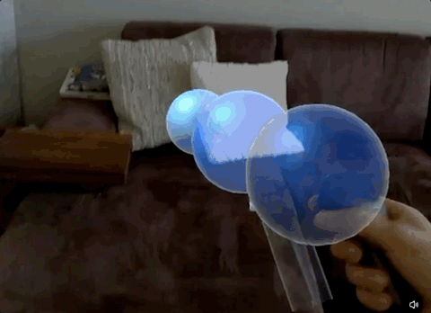
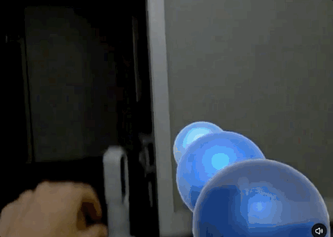

# magic-bubbles
A Magic Leap prototype to demonstrate the device's interaction features via an engaging consumer app.

Built in 2018 for the Magic Leap One as a self-driven prototype, to turn a brand-new device’s input APIs into one consumer-style experience. The device has since been discontinued, so this repo is kept as a reference.

## Bubble Mechanics
The main mechanic is using the Magic Leap tracked controller as a bubble gun, where pulling the trigger shoots bubbles that then bounce with the environment and pop after a timeout. Touching the bubbles also pops them, and every bubble's pop sound effect is spatially anchored to the position of the bubble. An upward open palm also makes the bubbles bounce on your hand.

## Bubble Telekinesis
In order to exercise the Eye Tracking API, I built a "bubble telekinesis" feature, which lets you control the bubbles with your eyes. When you raise your palm outward, telekinesis is enabled, and then every bubble you look at freezes in mid air. Releasing your palm lets them continue to fall naturally, but making a fist simultaneously pops all the frozen bubbles.

## APIs demonstrated
The following Magic Leap APIs are exercised to build the interaction features in this app:

* **AR camera**, to render virtual assets in the user's real environment
* **Controller tracking**, to attach the bubble gun asset on the ML controller
* **Controller input**, to trigger bubble shooting by pulling the trigger
* **Mesh collisions**, to make the bubbles bounce on environment surfaces
* **Hand tracking**, to attach colliders and detect hand poses for bubble bouncing, popping, and telekinesis
* **Hand collisions**, to detect bubble collisions with an open palm (to bounce) or with an index finger (to pop)
* **Eye tracking**, to freeze bubbles you stare at (while holding the open palm pose)
* **Spatial audio**, to make every pop sound effect come from the bubble's position in space

## Build
The project uses Unity 2018.1.9f1-MLTP9.6 (Unity’s Magic Leap technical preview build).

Original demo thread (2018): https://twitter.com/andres/status/1033853348498161664
